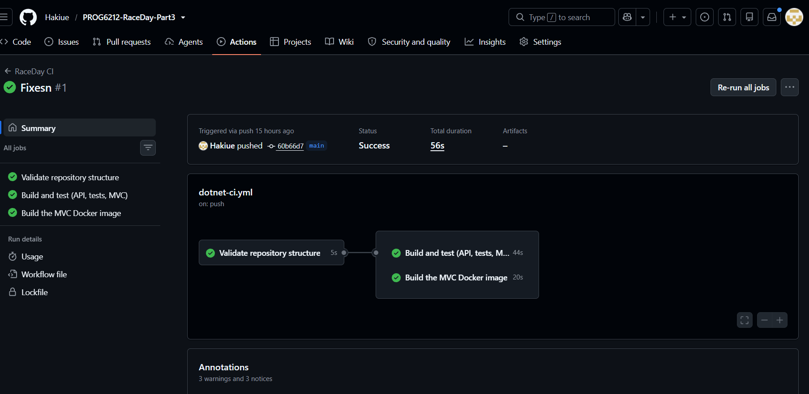

# RaceDay – Part 3: MVC web app, Azure Blob Storage and Docker

RaceDay is a web-based event management system for South African road running, walking and cycling events (PROG6212, Programming 2B).

| Part | What it adds |
|---|---|
| 1 | ERD, API endpoint plan and SQL script (`/docs`) |
| 2 | ASP.NET Core Web API (Code-First EF Core, SQL Server), Swagger, xUnit tests |
| **3** | **ASP.NET Core MVC front end, Azure Blob Storage inside the API, Docker** |

- **YouTube video (unlisted):** `PASTE LINK HERE`
- **CI status:** 

## The two roles

| Role | Can do |
|---|---|
| **Organiser** | Create, edit and delete their own events (with banner image), manage categories, view and confirm/cancel entries, capture and publish results, see a dashboard of their events |
| **Participant** | Create an account, browse and filter upcoming events, view event details and categories, enter an event by choosing a category, see their own entries and statuses, see their own results, edit their profile and upload a profile picture |

Role rules are enforced in the API on every call (Part 2). The MVC app mirrors them with a separate menu per role and redirects, but never relies on that alone.

## How the pieces fit together

```
Browser ──► RaceDayMvc (MVC, :5100) ──HTTP──► RaceDayApi (:5000) ──► SQL Server
                                                   │
                                                   └──► Azure Blob Storage (banners, profile pictures)
```

- **RaceDayMvc** has no database code and no business rules. Every read and write is an HTTP call made through one typed client (`IRaceDayApi` / `RaceDayApiClient`).
- **Session handling:** the API logs users in with a session cookie. The MVC server stores that cookie in its own session (`ApiSessionHandler`) and sends it on later calls, so the browser never sees the API cookie. The MVC session also holds the user id, role and display name.
- **Azure Blob Storage** is used only by the API. The MVC app sends the file to the API (`POST /api/events/{id}/banner`, `PUT /api/users/me/profile-picture`). The API stores it in a private container, saves the blob URL in the database and returns a short-lived read-only SAS link for display.

## Pages

| Area | Pages |
|---|---|
| Everyone | Home (upcoming events with filters), Event details, Log in, Register |
| Participant | My entries (colour-coded status), My results (finish time and "47th out of 312 finishers"), Profile (details and picture) |
| Organiser | Dashboard, My events (create / edit / delete, banner upload), Categories, Entries (confirm / cancel), Results (capture and publish) |

Enrolment statuses are colour coded: green Confirmed, amber Pending, red Cancelled.

## Prerequisites

- .NET SDK 9 or newer (the projects target `net9.0`)
- SQL Server Express (instance `SQLEXPRESS`) or any SQL Server; edit `RaceDayApi/appsettings.json` if yours differs
- Docker Desktop (for the container)
- Optional: an Azure Storage account (or the Azurite emulator) for image uploads

## Run it locally

From the folder that contains `RaceDayApi.sln`:

```powershell
dotnet build
dotnet test
```

Start the API (terminal 1). On first start it applies the database migrations and seeds the Run, Walk and Cycle event types:

```powershell
dotnet run --project RaceDayApi
```

Swagger: http://localhost:5000/swagger

Start the MVC app (terminal 2):

```powershell
dotnet run --project RaceDayMvc
```

Open http://localhost:5100.

> In `appsettings.json` the SQL Server instance name needs a doubled backslash: `localhost\\SQLEXPRESS`.

## Azure Blob Storage setup

Image uploads need a storage connection string. **Never commit it.** Store it with user-secrets:

```powershell
dotnet user-secrets set "BlobStorage:ConnectionString" "YOUR-CONNECTION-STRING" --project RaceDayApi
```

or set the environment variable `BlobStorage__ConnectionString` before starting the API.

The API creates the private container `raceday-images` on first upload. Without a connection string the upload endpoints return 503, the MVC app shows "image storage isn't set up" and everything else keeps working.

Local alternative without an Azure account (Azurite emulator):

```powershell
docker run -d --name azurite -p 10000:10000 mcr.microsoft.com/azure-storage/azurite azurite-blob --blobHost 0.0.0.0
dotnet user-secrets set "BlobStorage:ConnectionString" "UseDevelopmentStorage=true" --project RaceDayApi
```

## Run the MVC app in Docker

The API must be running on your PC first (`dotnet run --project RaceDayApi`). Then, from the folder that contains the `Dockerfile`:

```powershell
docker build -t raceday-mvc .
docker run --rm -p 5100:8080 -e Api__BaseUrl=http://host.docker.internal:5000/ raceday-mvc
```

Open http://localhost:5100. It behaves the same as the local app.

- Inside a container `localhost` means the container itself, so the API is reached at `host.docker.internal`.
- If the page says it can't reach the RaceDay service, start the API so it also listens outside localhost: `dotnet run --project RaceDayApi --urls "http://0.0.0.0:5000"`.
- ASP.NET Core reads nested settings from environment variables with a double underscore, so `Api__BaseUrl` sets `Api:BaseUrl`.

The Dockerfile is multi-stage: the .NET 9 SDK image restores (cached layer) and publishes, then only the published output is copied into the smaller ASP.NET 9 runtime image, which runs as a non-root user.

## Tests and CI

- `dotnet test` runs 40 xUnit tests. They start the real API in memory with the EF Core InMemory provider and a fake blob service, so no SQL Server or Azure account is needed.
- GitHub Actions (`.github/workflows/dotnet-ci.yml`) runs on every push:
  1. **Validate repository structure:** required files and folders exist and every project is in the solution.
  2. **Build and test:** restores, builds the whole solution (API, tests and MVC) and runs all tests.
  3. **Docker build:** builds the MVC image.

## Deviations from the Part 1 plan

- The Part 1 plan listed 25 endpoints. Part 3 adds one: `GET /api/eventtypes` (fills the event type dropdown and filter).
- The two Blob endpoints in the plan (event banner and profile picture) were deferred from Part 2 and are implemented in Part 3.
- `GET /api/events` gained an optional `upcomingOnly=true` filter.
- Responses gained fields the pages need: `eventTypeId` and `enrolmentCount` (events); `participantName`, `participantEmail`, `eventDate` (enrolments); `participantName`, `eventId`, `totalFinishers` (results).
- Deleting an event or category that has enrolments now returns `409 Conflict`; invalid event, result and profile input returns `400`.
- "Publish" results: a result is visible to the participant as soon as the Organiser saves it, so saving and publishing are one step.
- Database differences from the Part 1 script are listed in the Part 2 README.

## AI use disclosure

An AI assistant (Claude) was used to plan and draft parts of this project, including code for the API and MVC app, the Dockerfile and the CI workflow. I reviewed, ran and tested the work and can explain how it works. The video voiceover is my own voice.

## Student

Name: `YOUR NAME` · Student number: `YOUR NUMBER`
